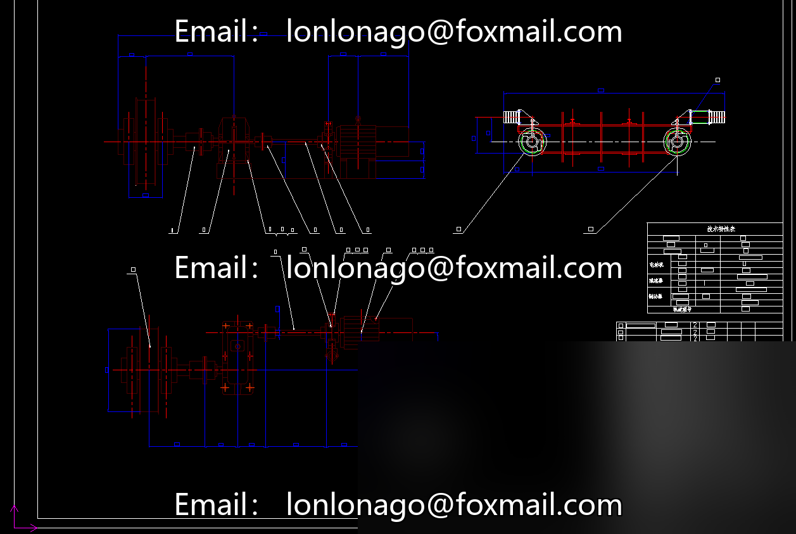
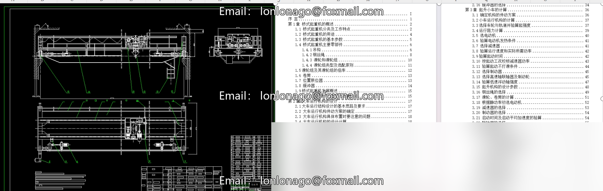
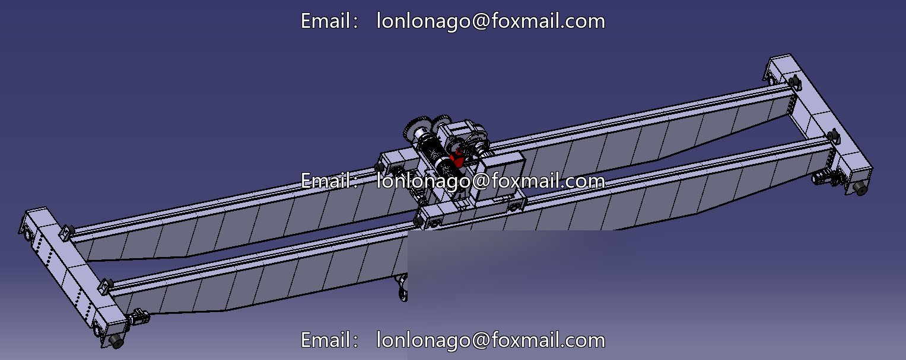

# 45. Overall design of 10-ton bridge crane 10-ton bridge crane overall design diagram

## Body

45. 10t Bridge Crane Overall Design 10t Bridge Crane Overall Design Drawing 10t Bridge Crane Overall Design CAD Drawing
Primary design content is the structure and running mechanism of a 10t bridge crane. Including the layout calculation and verification of the cable trenching structure. Main beam structural calculation and verification The calculation and verification of the end beam structure Main beam connection and selection and verification of large vehicle running mechanism components include.

Including assembly drawings. Part drawings and design descriptions. Additionally, a 3D diagram of a similar structure bridge crane type is granted free of charge, for specific reference, refer to the accompanying figure.

Purchase requirements
1. All materials are drawing-type (not physical objects), the network has replicability, and after transaction completion, refunds are not accepted. Please consult before purchase for any issues.
2. All materials are for reference and learning purposes for beginners and shall not be used for illegal purposes.
3. Design is a comprehensive test, it is recommended not to copy from the original without modification. For final design, there is no after-sales modification service.

The data includes the overall design of a 10t bridge crane, covering structural and operation mechanisms, bridge frame layout verification, main beam and end beam calculations, assembly diagrams, parts drawings and design notes.

<!-- AI_ENRICHED -->

## Images

## Payment

Here is a pay link on Stripe ( https://buy.stripe.com/3cs8yP7sY87d0vu9AB ). Please contact me lonlonago@foxmail.com after funding $89, and I will send you a complete data files , thank you!

